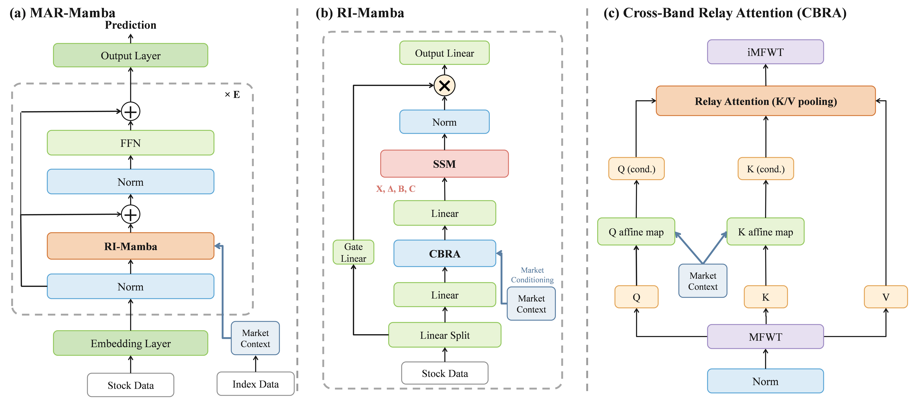

<div align="center">

# MAR-Mamba

### Market-Adaptive Relay Learning with MFWT for Stock Return Prediction

[](https://www.python.org/)
[](https://pytorch.org/)
[](LICENSE)

</div>



## Overview

MAR-Mamba is a PyTorch model for cross-sectional stock return prediction. It combines a learnable Multi-Frequency Wavelet Transform (MFWT), market-conditioned Cross-Band Relay Attention (CBRA), and selective state-space modeling.

## Installation

```bash
pip install -r requirements.txt
```

## Quick Start

```python
import torch
from mar_mamba import MARMamba

model = MARMamba(
    d_feat=158,
    num_stocks=500,
    market_dim=63,
)

stock = torch.randn(500, 30, 158)
market = torch.randn(30, 63)
scores = model(stock, market)
```

The stock input has shape `[N, T, F]`, the market input has shape `[T, C]`, and the output has shape `[N]`. Inputs for day `t` should contain observations only through day `t-1`.

## Notes

- Use a fixed stock order for each dataset.
- Original MASTER checkpoints are not compatible with MAR-Mamba.

## License

Released under the [MIT License](LICENSE). This project is based on the public MASTER repository.
